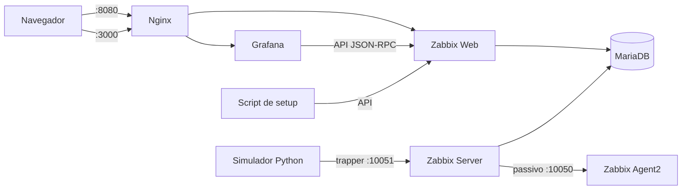
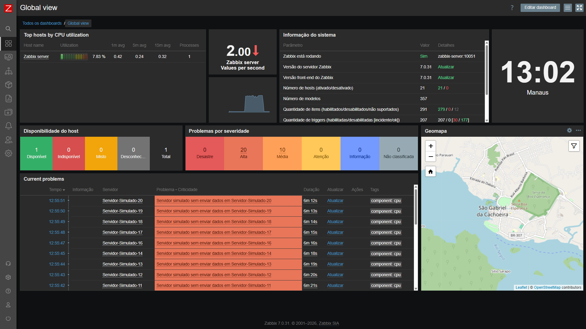
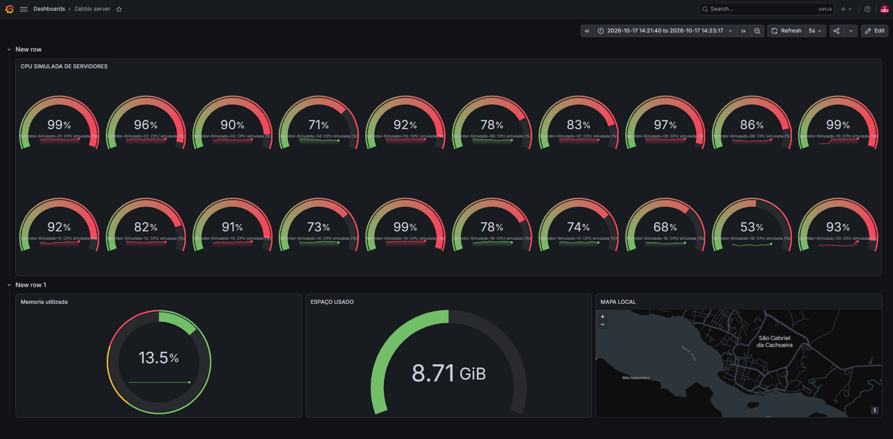
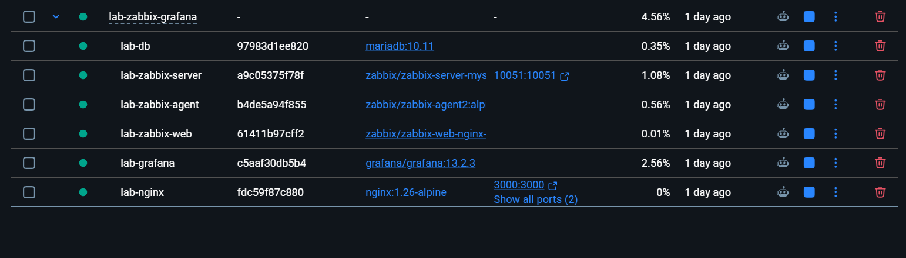

# Lab de monitoramento: Zabbix + Grafana + Nginx com Docker Compose

> **English summary:** a self-contained monitoring lab built with Docker Compose: Zabbix 7.0 LTS (server, web and agent), MariaDB, Grafana with the Zabbix plugin and an Nginx reverse proxy. A Python script (`zabbix_utils`) provisions the Zabbix objects through the API and a second one simulates CPU metrics for 20 servers. All data is simulated and the stack is meant for study, not for production.

## O que é

Projeto de estudo e portfólio. Reproduz, em escala de laboratório, o tipo de ambiente de monitoramento (Zabbix + Grafana) com o qual já trabalhei em ambiente corporativo. **Todos os dados são simulados** e este repositório não contém informações de nenhuma organização.

O que o laboratório demonstra:

- Subir uma stack de monitoramento completa com **Docker Compose** (healthcheck, rede dedicada, volumes nomeados, segredos fora do código).
- **Nginx como proxy reverso** na frente do Zabbix Web e do Grafana (inclui suporte a WebSocket para o Grafana Live).
- **Grafana provisionado por arquivos**: plugin e datasource do Zabbix já chegam configurados.
- **Automação em Python**: o script de setup cria template, item, trigger e hosts pela API do Zabbix (idempotente), e o simulador envia métricas pelo protocolo trapper.

## Arquitetura



| Serviço | Imagem | Acesso no host |
|---|---|---|
| Zabbix Web | `zabbix/zabbix-web-nginx-mysql:alpine-7.0-latest` | via Nginx: http://localhost:8080 |
| Grafana | `grafana/grafana` (versão em `GRAFANA_VERSION`) | via Nginx: http://localhost:3000 |
| Zabbix Server | `zabbix/zabbix-server-mysql:alpine-7.0-latest` | porta `10051` (recebe o simulador) |
| Zabbix Agent2 | `zabbix/zabbix-agent2:alpine-7.0-latest` | somente rede interna |
| Banco de dados | `mariadb:10.11` | somente rede interna |
| Proxy | `nginx:1.26-alpine` | portas `8080` e `3000` |

## Pré-requisitos

- Docker e Docker Compose v2
- Python 3.9+ (para os scripts que rodam no host)

## Como subir

```bash
# 1. Configuração: copie o exemplo e TROQUE as senhas
cp .env.example .env

# 2. Suba o ambiente (a primeira inicialização leva 1 a 2 minutos)
docker compose up -d
docker compose ps

# 3. Dependências dos scripts
python -m venv .venv
source .venv/bin/activate        # Windows: .venv\Scripts\activate
pip install -r requirements.txt

# 4. Crie template, item, trigger e 20 hosts simulados via API
python scripts/setup_zabbix.py

# 5. Envie métricas simuladas (Ctrl+C para parar)
python scripts/simulador_zabbix.py
```

Atalhos com `make`: `make up`, `make setup`, `make simulate`, `make logs`, `make down` e `make reset` (apaga os volumes).

### Acessos

| O quê | Onde | Credenciais iniciais |
|---|---|---|
| Zabbix | http://localhost:8080 | `Admin` / `zabbix` (**troque a senha no primeiro acesso**) |
| Grafana | http://localhost:3000 | valores de `GRAFANA_ADMIN_USER` e `GRAFANA_ADMIN_PASSWORD` no `.env` |

Ao trocar a senha do `Admin` no Zabbix, atualize `ZABBIX_ADMIN_PASSWORD` no `.env` e recrie o Grafana (`docker compose up -d grafana`) para o datasource continuar funcionando.

### Primeiros passos no Grafana

O plugin e o datasource **Zabbix** já vêm provisionados. Para ver dados rapidamente: abra **Plugins → Zabbix → aba Dashboards** e importe um dos dashboards que acompanham o plugin, ou crie o seu em **Dashboards → New** escolhendo o datasource Zabbix e o grupo `Lab/Servidores Simulados`.

## O que o script de setup cria

| Objeto | Nome |
|---|---|
| Grupo de hosts | `Lab/Servidores Simulados` |
| Grupo de templates | `Lab/Templates` |
| Template | `Template Lab Servidor Simulado` |
| Item (trapper) | `cpu.simulada`, numérico, em % |
| Trigger | `CPU simulada acima de 90% em {HOST.NAME}` (severidade Average) |
| Hosts | `Servidor-Simulado-01` a `Servidor-Simulado-20` |
| Ajuste extra | interface do host `Zabbix server` apontada para o contêiner `zabbix-agent` |

Rodar o script de novo não duplica nada. A quantidade de hosts muda com `--hosts N` (use o mesmo valor no simulador).

## Estrutura do repositório

```
.
├── docker-compose.yml
├── .env.example
├── requirements.txt
├── Makefile
├── nginx/
│   └── default.conf                  # proxy reverso Zabbix (8080) e Grafana (3000)
├── grafana/provisioning/
│   ├── datasources/zabbix.yml        # datasource Zabbix
│   └── plugins/zabbix-app.yml        # habilita o app do Zabbix
├── scripts/
│   ├── comum.py                      # leitura do .env e nomes dos hosts
│   ├── setup_zabbix.py               # provisiona objetos via API do Zabbix
│   └── simulador_zabbix.py           # envia métricas simuladas (trapper)
└── docs/img/                         # prints do ambiente rodando
```

## Decisões de projeto

- **Segredos fora do código:** senhas vêm do `.env` (ignorado pelo Git); o compose falha com mensagem clara se faltarem.
- **`depends_on` com healthcheck:** o Zabbix só sobe depois que o MariaDB aceita conexões.
- **Superfície mínima:** banco, Zabbix Web e Grafana não publicam portas no host; só o Nginx e o trapper (10051).
- **Provisionamento por arquivos:** o Grafana nasce configurado e o ambiente é reproduzível com `docker compose up`.
- **Setup idempotente:** cada objeto é consultado antes de ser criado.

## Segurança

Este ambiente é um **laboratório**. Não o exponha na internet nem o use em produção: não há TLS, a senha inicial do Zabbix é conhecida e o trapper aceita dados de qualquer origem. Para um uso real, seria preciso TLS no Nginx, usuários de API dedicados com permissões mínimas, restrição de origem no trapper e backup do banco.

## Solução de problemas

- **Simulador mostra `falhas > 0`:** os hosts ou o item ainda não existem. Rode `python scripts/setup_zabbix.py`.
- **Setup não conecta:** aguarde o Zabbix terminar de inicializar (`docker compose logs -f zabbix-server`). O script tenta novamente por até 2,5 minutos.
- **Plugin do Zabbix não aparece no Grafana:** veja `docker compose logs grafana`. Se for incompatibilidade de versão, fixe uma versão anterior em `GRAFANA_VERSION` no `.env` e rode `docker compose up -d grafana`.
- **Host "Zabbix server" indisponível:** ajuste a interface do agente para DNS `zabbix-agent`, porta `10050`.
- **Porta ocupada:** altere `NGINX_ZABBIX_PORT` ou `NGINX_GRAFANA_PORT` no `.env` (e `ZABBIX_WEB_URL`, se mudar a porta do Zabbix).


## Prints do ambiente






-->

## Licença

MIT. Veja o arquivo [LICENSE](LICENSE).
